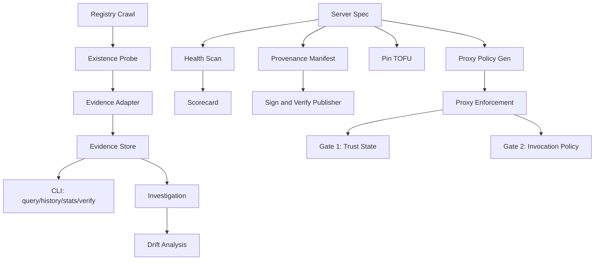

# Trustcard in Five Minutes

> Install, pin, scan one server, read evidence. No prior knowledge needed.

---

## 1. Install (30 seconds)

```bash
npm install -g mcp-trustcard
```

Verify:
```bash
mcp-trustcard --help
```

## 2. Scan a server (1 minute)

Scan any MCP server to get a health scorecard:

```bash
# Scan an npm package
mcp-trustcard scan @modelcontextprotocol/server-filesystem

# Scan a local command
mcp-trustcard scan -- npx -y @modelcontextprotocol/server-filesystem

# Scan a remote server
mcp-trustcard scan https://api.example.com/mcp
```

Output: a scorecard with handshake, tools, security checks, and a trust score.

## 3. Record provenance and pin (1 minute)

trustcard has two different manifest types — they are not interchangeable:

- **Provenance manifest** (`manifest`) — a signed statement of "what this
  server was at a point in time": tool definitions, protocol, publisher
  identity, digests. Produced by `mcp-trustcard manifest`, then `sign`.
- **Proxy-enforcement manifest** (`gen-manifest`) — the allow/deny policy a
  proxy enforces at call time. Unsigned by design.

Create provenance first:

```bash
# Generate a publisher keypair (keep the private key private)
mcp-trustcard keygen --out my-key.json

# Create an UNSIGNED provenance manifest, embedding your public publisher
# identity (--key embeds identity; it does not sign)
mcp-trustcard manifest @modelcontextprotocol/server-filesystem \
  --key my-key.json --out server-manifest.json

# Sign it — the private key signs, producing a verified provenance record
mcp-trustcard sign server-manifest.json --key my-key.json --out server-signed.json

# Verify it
mcp-trustcard verify server-signed.json

# Pin it (TOFU — trust on first use)
mcp-trustcard pin @modelcontextprotocol/server-filesystem

# List pins
mcp-trustcard pins
```

Provenance manifests expire after 90 days by default (`--expires-in` or
`--no-expiry`); an expired signed manifest fails `verify`.

## 4. Run a proxy with enforcement (1 minute)

The enforcement proxies consume the **proxy manifest** from `gen-manifest`,
not the signed provenance manifest:

```bash
# Generate a proxy manifest (allow/deny policy + contract digests)
mcp-trustcard gen-manifest @modelcontextprotocol/server-filesystem \
  --save-manifest policy.json

# stdio server — the proxy sits between your client and the server
mcp-proxy --manifest policy.json -- npx -y @modelcontextprotocol/server-filesystem

# HTTP server — a local forward proxy enforces the same policy
mcp-http-proxy --manifest policy.json --upstream https://api.example.com/mcp --port 8080
```

## 5. Verify the gate (1 minute)

Inspect the exact policy the proxy enforces, then exercise the configured
route from your MCP client:

```bash
mcp-trustcard inspect policy.json
mcp-trustcard status --config /absolute/path/client-config.json
```

`scan` produces a scorecard; it does not write to the evidence store. Evidence
commands operate on records created explicitly by evidence-producing workflows.

---

## What you have now

- A **health scorecard** for any MCP server
- A **signed manifest** that cryptographically identifies a server's capabilities
- A **TOFU pin** that detects if the server changes
- An **enforcement proxy** that blocks dangerous tools and unauthorized calls
- A concrete policy you can inspect and verify through the configured route

## Next steps

- `mcp-trustcard diff <old.json> <new.json>` — classify what changed between manifests
- `mcp-trustcard fingerprint <spec>` — full identity card for a server
- `mcp-trustcard inspect <file>` — inspect a manifest or pin store
- `mcp-trustcard scan-config <config.json>` — scan a config file for exposed secrets
- `mcp-trustcard --strict <spec>` — CI mode, exit 1 on any FAIL

## Architecture (one page)


